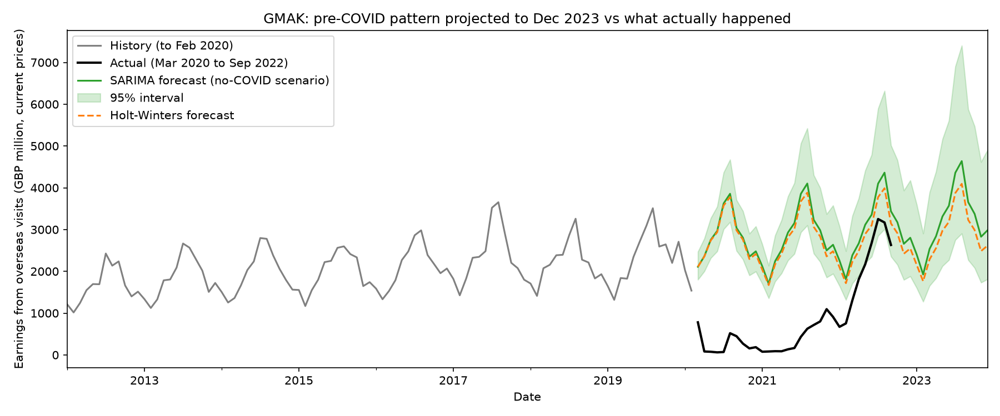
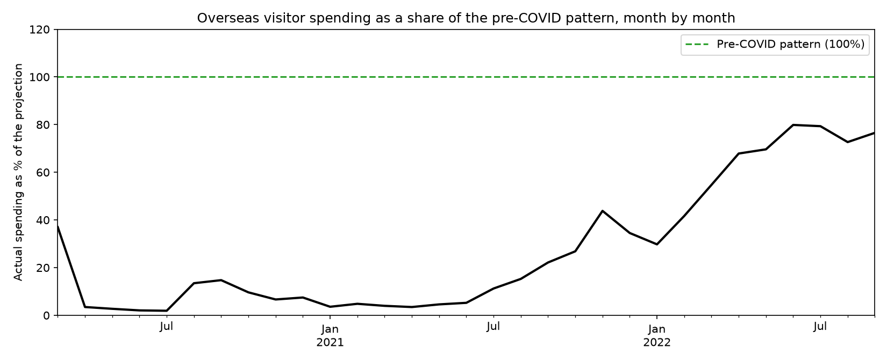
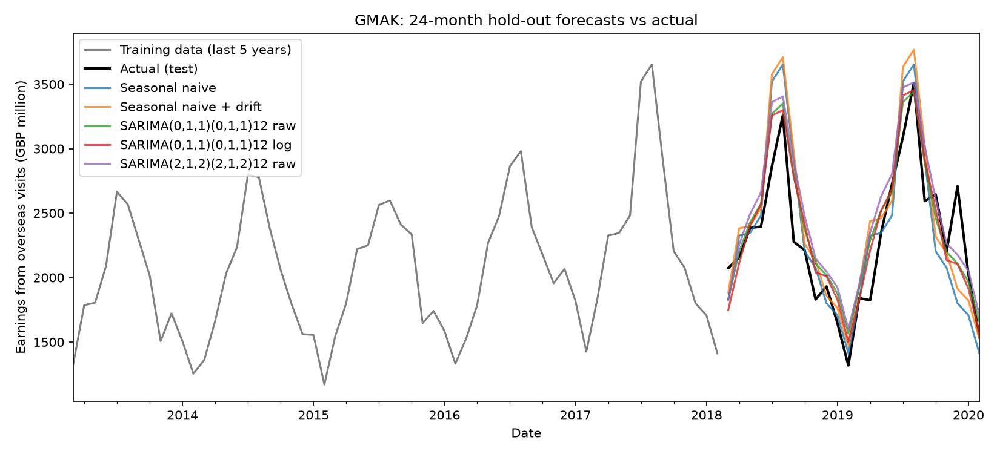
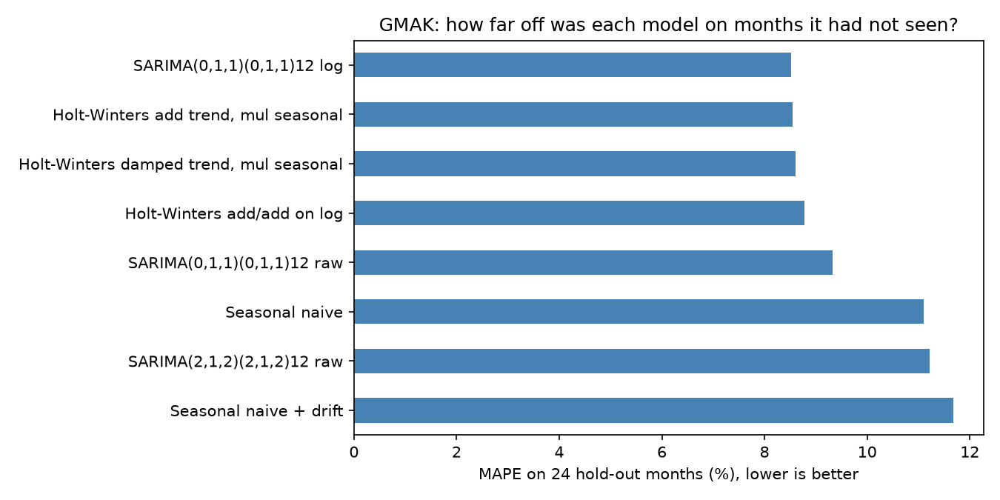
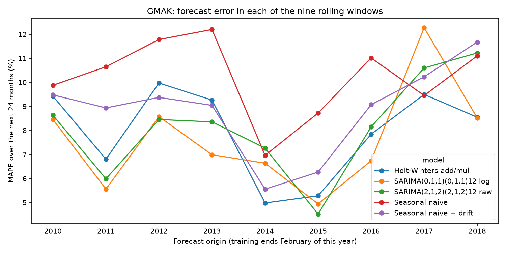
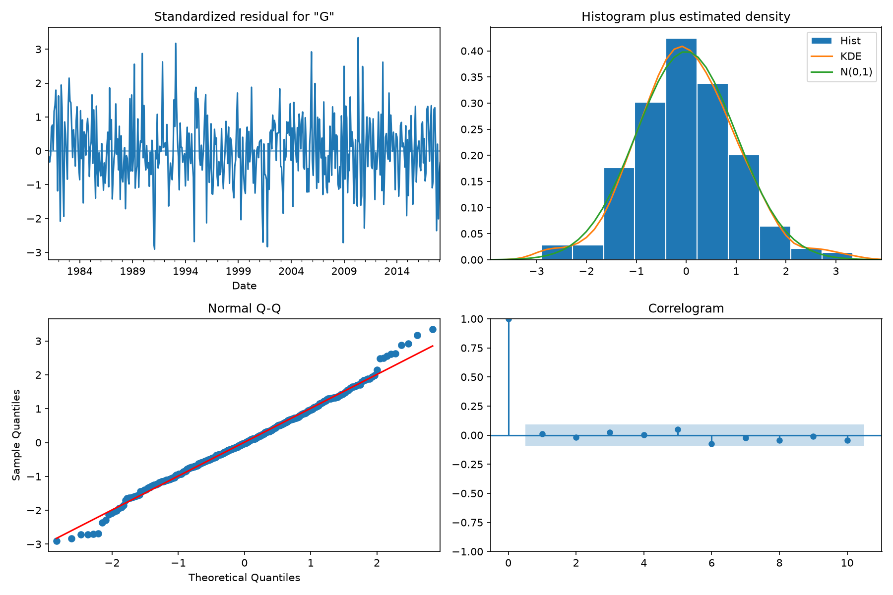

# UK Tourism Spending Through COVID and the Early Recovery

### Forecasting overseas visitor earnings with ONS data

Overseas visitors spent about £28bn in the UK in 2019. If that pattern had simply continued after February 2020, how much would they have spent, and how far below it did actual spending fall through the pandemic and the early recovery (to September 2022)? Before answering, I tested which forecasting methods can be trusted on this data.

Data: ONS series GMAK. Tools: Python, pandas, statsmodels, matplotlib.

## The short answer

- **Forecasting this series works well enough to be useful.** Simple seasonal methods predict a typical month to within about 8%, on months they had never seen.
- **Spending nearly stopped, then recovered slowly.** From March 2020 to September 2022 visitors spent about £26bn, against £86-90bn implied by the pre-COVID pattern. That is roughly 70% lower.
- **By September 2022 spending was back to about three-quarters of the old pattern** (SARIMA projection; Holt-Winters gives a slightly higher share).

## What I found

### 1. Spending almost disappeared, then climbed back

The black line is actual spending from March 2020. The green line is what the pre-COVID pattern implied, with a 95% range around it.



Between April and July 2020 spending was under 4% of that pattern. Month by month, the recovery looks like this:



| Period | Months | Actual spending | Share of the projected spending |
|---|---|---|---|
| 2020 (Mar-Dec) | 10 | £2.6bn | about 9% |
| 2021 | 12 | £5.2bn | about 15% |
| 2022 (Jan-Sep) | 9 | £18.4bn | about 67% |

The shares use the SARIMA projection. Holt-Winters gives similar figures (about 10%, 16% and 73%), and the full table is in `results/05_yearly_gap.csv`.

Over the whole period, actual spending was £26.3bn against a projected £85.8-89.8bn, a gap of £59.5-63.5bn. That is roughly two years' worth of 2019 spending (£28.4bn). Two cautions apply. All pound figures are in each year's own money, not adjusted for inflation. And the gap is a scenario, not a measured effect of COVID: other changes over 2020-2022, such as exchange rates, prices and Brexit, are not separated out.

### 2. How far can the forecasts be trusted?

On months the models had not seen, the best ones were off by about 7-8%. On an average month of roughly £2.3bn, that is a miss of about £180m. An error of 8% is small next to a 70% shortfall, so the main message is solid. The exact total is less certain, which is why I quote a range.

### 3. Simple methods did as well as complex ones, and repeating the test changed the picture

I compared a classic seasonal model on log-transformed data (SARIMA), Holt-Winters, a more complex SARIMA, and two baselines: repeating last year's value, with and without average growth. This is how they did on the latest 24 months set aside for testing:





On that single test, the complex model did no better than copying last year's values (11.2% vs 11.1% error). One test can mislead, because a single window has its own particular conditions, so I repeated it over nine windows. The complex model then averaged 8.1%, close to the simpler models (7.6% for the log SARIMA and 8.0% for Holt-Winters), and all three beat the baselines (8.9% and 10.2%).

## What this means

- For one-to-two-year planning on a seasonal series like this, a simple model on logs, or Holt-Winters, is enough. The extra complexity did not pay for itself.
- Judge forecasts on months the model has not seen, and repeat the test.
- Report a loss as a range with its assumptions. "Actual spending as a share of the pre-COVID pattern" is a simple recovery measure that a non-specialist can track.

## Scope and limitations

**Covered:** one series (monthly earnings from overseas visits, GMAK); SARIMA, Holt-Winters and two baselines; a 24-month hold-out, nine rolling windows and two robustness variants; a comparison with actual data to September 2022.

**Not covered:** the other series from the original coursework, regression with outside drivers, and any adjustment for inflation or exchange rates. An inflation-adjusted version is a natural next step.

**Limitations:**
- Test windows are pre-COVID and 24 months long. The final forecast runs 46 months, further than anything tested.
- The nine main windows overlap, so they are not nine independent tests. The non-overlapping designs agree on the ranking.
- The top three models are within about half a percentage point of each other.
- Prediction intervals assume roughly normal errors on the log scale, and the errors have slightly heavy tails.
- The data is a 2023 download, and later ONS revisions are not reflected.

<details>
<summary><b>Technical details: full results, tables and checks</b></summary>

Errors are in £ million per month (MAE, RMSE) or percent (MAPE). Lower is better.

**Single hold-out: trained to Feb 2018, tested on Mar 2018 to Feb 2020** (`src/01`, `src/04`)

| Model | MAE | RMSE | MAPE % |
|---|---|---|---|
| Holt-Winters, additive trend, multiplicative seasonality | 192.7 | 247.9 | 8.55 |
| SARIMA(0,1,1)(0,1,1)12 on log data | 191.0 | 249.1 | 8.52 |
| Holt-Winters, damped trend, multiplicative seasonality | 194.2 | 249.3 | 8.61 |
| Holt-Winters, additive/additive on log data | 193.3 | 252.4 | 8.78 |
| SARIMA(0,1,1)(0,1,1)12 on raw data | 204.5 | 258.1 | 9.33 |
| SARIMA(2,1,2)(2,1,2)12 on raw data | 244.7 | 300.3 | 11.22 |
| Seasonal naive (baseline) | 264.0 | 350.5 | 11.10 |
| Seasonal naive + drift (baseline) | 278.0 | 364.2 | 11.68 |

**Rolling origin: nine windows, each 24 months** (`src/06`)

| Model | Avg MAE | Avg RMSE | Avg MAPE % | Windows won |
|---|---|---|---|---|
| SARIMA(0,1,1)(0,1,1)12 on log data | 153.7 | 191.9 | 7.63 | 5 |
| Holt-Winters add/mul | 162.6 | 205.6 | 7.96 | 3 |
| SARIMA(2,1,2)(2,1,2)12 on raw data | 166.8 | 211.2 | 8.14 | 1 |
| Seasonal naive + drift | 182.0 | 235.0 | 8.85 | 0 |
| Seasonal naive | 208.6 | 266.9 | 10.20 | 0 |

The ranking is the same with five non-overlapping 24-month windows and with ten non-overlapping 12-month windows (`results/06_rolling_summary.csv`). The log SARIMA is slightly ahead of Holt-Winters, but not clearly better.



**Residual checks on the chosen model** (`src/03`): no leftover autocorrelation (Ljung-Box p = 0.89 at lag 12 and 0.96 at lag 24), steady error size (p = 0.79), and slightly heavier tails than normal (Jarque-Bera p = 0.034).



</details>

## Glossary

- **Baseline:** the simplest sensible forecast, such as "same month as last year". A model must beat it to be worth using.
- **Hold-out test:** hiding the most recent months, forecasting them, and comparing with what really happened.
- **Rolling windows:** repeating the hold-out test at several earlier points in time, then averaging.
- **MAPE:** the average miss as a percentage of the actual value. On ₹1,00,000 of monthly sales, 8% means being off by about ₹8,000.
- **SARIMA and Holt-Winters:** two standard methods that learn the trend and yearly seasonal pattern from past data.
- **Projection:** the forecast of what spending would have been had the pre-2020 pattern continued.

More detail on each idea is in [`docs/method_notes.md`](docs/method_notes.md).

## Data

- **Series:** ONS GMAK, overseas visits to the UK: earnings, £ million per month, not seasonally adjusted, in current prices. Source: ONS [International Passenger Survey time series](https://www.ons.gov.uk/peoplepopulationandcommunity/leisureandtourism/datasets/internationalpassengersurveytimeseriesspreadsheet).
- **Period:** January 1980 to September 2022 in my file. Models are fitted only up to February 2020, the last month before COVID travel restrictions. Later months are used only for the comparison.
- **Not included in this repository.** Download the series from ONS and save the monthly values in `data/gmak.xlsx`, in a sheet named `GMAK` with two columns: `Date` (first day of each month, stored as a real date) and `GMAK`. My copy was downloaded in March 2023, and ONS revises its figures, so newer downloads may differ slightly. Please check the ONS licence terms for reuse.

## Reproduce it

```bash
git clone https://github.com/Tanushri02/uk-tourism-earnings-forecasting.git
cd uk-tourism-earnings-forecasting
python3 -m venv .venv
source .venv/bin/activate          # Windows: .venv\Scripts\activate
pip install -r requirements.txt
```

Put `gmak.xlsx` in `data/`, then run the scripts in numeric order, for example `python src/01_holdout_baseline.py`. Developed with Python 3.13, pandas 3.0 and statsmodels 0.15. Small numerical differences between machines are normal. Charts are saved to `figures/` and tables to `results/`.

| File | Purpose | Run time |
|---|---|---|
| `common.py` | Loads the data, splits it, scores forecasts, defines the baselines | (helper) |
| `01_holdout_baseline.py` | Fits on data to Feb 2018, forecasts 24 months, compares with actuals | seconds |
| `02_sarima_grid.py` | Ranks 36 SARIMA settings by AIC on training data only | about 15 s |
| `03_residual_checks.py` | Checks the chosen model's errors for leftover patterns | seconds |
| `04_holt_winters_compare.py` | Adds Holt-Winters and builds the comparison table | seconds |
| `05_final_forecast.py` | Refits on all pre-COVID data, forecasts to Dec 2023, compares year by year | seconds |
| `06_rolling_origin.py` | Repeats the test over nine windows, plus two robustness designs | about 2 min |
| `07_reselect_order_check.py` | Repeats the order search inside each window to rule out peeking (optional) | a few min |

## Modelling notes

- **Order selection:** 36 combinations ranked by AIC on training data only. Five were within 2 AIC points of the best, and the simplest was chosen. Repeating the search inside each rolling window chose the same model every time.
- **Convergence:** SARIMA fits are allowed 500 optimiser attempts. In the 36-model search, 35 fits converged on my machine. The one that did not, SARIMA(1,1,0)(0,1,0)12, ranked far below the top five (AIC -719 against -973), and refitting it with 3,000 attempts did not change its score. The models compared in the hold-out and rolling tests all converged.
- **Log model:** forecasts are converted back with `np.exp`, which gives median forecasts.

## About this project

**Where it came from.** This started as group coursework in my MSc forecasting module at the University of Southampton. The task was to forecast monthly UK tourism indicators from ONS data and compare exponential smoothing with ARIMA. I did the ARIMA modelling. Going back to it recently, I recognised gaps in both my understanding and my execution. With more capable AI tools now available, I decided to rebuild the analysis more thoroughly and publish it.

**What changed.**

| | My original coursework approach | This project |
|---|---|---|
| How models were judged | On the data they had been fitted to | On a 24-month hold-out and nine rolling windows of unseen months |
| A point of comparison | None | Simple baselines |
| Transformation | Explored a transformation, but fitted the model on raw values | Fitted on logs, and compared with raw |
| Choosing the model | A few candidates compared by AIC | 36 candidates ranked by AIC on training data only |
| After March 2020 | COVID months removed; the forecast was never compared with what happened | Compared with actual data to September 2022 |
| Conclusions | Some written conclusions were stronger than the test results supported | Calculated checks, with caveats and robustness tests stated |

The coursework brief, data files, report and poster are not part of this repository. Everything here is new code on public ONS data.

**How it was built.** AI tools were part of the process: an AI assistant helped me review my original approach, identify the gaps above, and draft code and explanations. I ran every step, compared the results with my own runs, and can explain each part.

## References

- Hyndman, R.J. and Athanasopoulos, G., [Forecasting: Principles and Practice](https://otexts.com/fpp3/), 3rd edition.
- Office for National Statistics, International Passenger Survey, series GMAK.

## Licence

MIT. See `LICENSE`.
